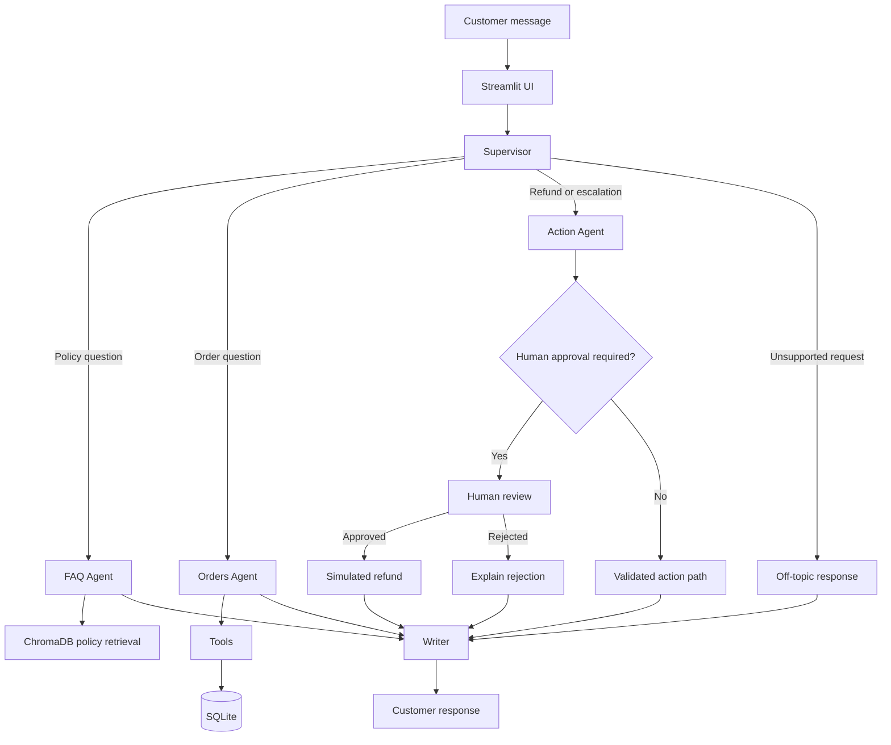

# SupportCopilot — Multi-Agent AI Customer Support Assistant

SupportCopilot is an AI customer support assistant built for a fictional electronics store called **ShopEasy**. It uses LangGraph to orchestrate specialized agents, retrieval-augmented generation (RAG) to answer policy questions, and tools to retrieve customer-specific order information.

The project demonstrates how LLM applications can combine retrieval, tools, persistent state, security checks, and human approval for sensitive actions.

> **Project status:** Portfolio prototype. All business data is synthetic, and refunds are simulated. Verify each feature and test result against the current code before describing it as fully implemented.

## Features

- **Multi-agent workflow:** Routes requests to specialized FAQ, Orders, Action, and Writer components.
- **Policy Q&A with RAG:** Retrieves relevant return, refund, shipping, and warranty policy passages using ChromaDB.
- **Tool calling:** Uses order-management tools to retrieve permitted order information and create support tickets.
- **LangGraph orchestration:** Uses graph state, nodes, edges, conditional routing, and workflow compilation.
- **Human-in-the-loop design:** Intended to pause higher-value refund requests for human review.
- **SQLite database:** Stores synthetic customers, orders, tickets, and simulated refund records.
- **Local embeddings:** Uses Sentence Transformers with `all-MiniLM-L6-v2` on CPU.
- **Streamlit interface:** Provides a customer chat interface and a human-agent dashboard.
- **Security checks:** Tests customer ownership before allowing order access.
- **Observability:** Supports LangSmith tracing when configured.
- **Evaluation starter:** Includes example cases and scripts to begin measuring routing, tool use, and guardrail behavior.

## Architecture



The diagram represents the intended workflow; individual paths should be checked against the actual implementation.

## Technology Stack

| Technology | Purpose |
|---|---|
| Python | Application logic |
| LangGraph | Stateful workflow and agent orchestration |
| LangChain | LLM integration and tool calling |
| Groq API | Hosted language model inference |
| ChromaDB | Policy-vector storage and retrieval |
| Sentence Transformers | Local text embeddings |
| SQLite | Synthetic business data and application records |
| Streamlit | Web interface |
| LangSmith | LLM tracing and debugging |
| uv | Python environment and dependency management |

The language model runs through the Groq API; embeddings run locally on the CPU. A GPU is not required.

## How It Works

1. The customer selects a demo account and submits a message.
2. The supervisor determines which workflow should handle the request.
3. The FAQ Agent retrieves relevant policy passages, or the Orders Agent invokes appropriate database tools.
4. The Action Agent handles supported refund or escalation workflows, subject to validation and approval requirements.
5. The Writer produces a customer-facing response based on available evidence.
6. The UI displays the result and, where supported, the current agent status.

## Retrieval-Augmented Generation (RAG)

1. Load the store's policy documents.
2. Split the documents into manageable chunks.
3. Embed each chunk using `all-MiniLM-L6-v2`.
4. Store the embeddings in ChromaDB.
5. Embed the customer's policy question and retrieve relevant chunks.
6. Generate an answer grounded in the retrieved text.

If the policy documents do not cover a question, the assistant should say that the information is unavailable rather than invent a rule.

## Security and Safety

- All customer and order records are synthetic.
- Order access must be scoped to the trusted customer selected by the application.
- The LLM must not be allowed to choose or override the authenticated customer identity.
- User messages, order notes, and retrieved policy text are untrusted inputs, not instructions to change system behavior.
- Refunds must be validated and idempotent, and any required human approval must occur before the side effect.
- The demo login is not production authentication.
- Refunds are simulated and do not issue real payments.

## Setup

Requirements: Python 3.11, Git, `uv`, and a Groq API key.

1. Clone this repository and enter the project directory.
2. Create and activate a virtual environment.
3. Copy `.env.example` to `.env`.
4. Add your own Groq API key locally.
5. Install the pinned dependencies.
6. Run the database initialization and smoke tests.
7. Start the Streamlit application.

Example Windows PowerShell commands:

```powershell
git clone https://github.com/YOUR-USERNAME/SupportCopilot.git
cd SupportCopilot

uv venv
.venv\Scripts\Activate.ps1

Copy-Item .env.example .env
uv pip install -r requirements.txt

python -m pytest
python -m streamlit run app.py
```

Check the project instructions for any required database or policy-index initialization command. Do not commit `.env`.

## Configuration

- `GROQ_API_KEY`: Required for Groq inference.
- `LANGCHAIN_TRACING_V2`: Enables LangSmith tracing if configured by the application.
- `LANGCHAIN_API_KEY`: LangSmith API key.
- `LANGCHAIN_PROJECT`: Optional LangSmith project name.
- `TAVILY_API_KEY`: Optional for a future web-search extension.

Verify that `openai/gpt-oss-20b` is currently available on Groq and supports the tool-calling and structured-output features used by this project. If not, choose a supported model and test it before changing the single model constant in `config.py`.

## Testing and Evaluation

Run the available tests before demonstrating the application. Expand the evaluation set to cover policy questions, order access, tool selection, ambiguous requests, refund decisions, prompt injection, and approval/resume behavior.

Record actual results from your own runs. Do not publish unmeasured accuracy, safety, or performance claims.

Suggested metrics:

| Metric | Your measured result |
|---|---|
| Routing accuracy | To be measured |
| Tool-use accuracy | To be measured |
| Answer correctness | To be measured |
| Guardrail pass rate | To be measured |
| Cross-customer data leaks | Target: 0; report measured count |

## Limitations

- This is a learning and portfolio prototype, not a production payment system.
- Demo login does not replace real authentication.
- Refund eligibility and approval/resume behavior require end-to-end validation.
- A small evaluation set cannot establish production reliability.
- Model APIs and Python package compatibility can change.

## Future Improvements

- Complete and test refund policy enforcement and idempotency.
- Validate persistent checkpointing and cross-session approval workflows.
- Expand the evaluation suite to 25–30 or more test cases.
- Add automated tests and continuous integration.
- Add trusted manufacturer-domain product help.
- Explore image-based damage evidence and hierarchical agent teams.

## Demo

Add a screenshot or GIF of the working Streamlit application here.

- `docs/screenshots/customer-chat.png`
- `docs/screenshots/approval-dashboard.png`
- `docs/demo.gif`

## LangSmith

Add screenshots of representative traces here after tracing has been configured and verified.

- `docs/screenshots/langsmith-trace.png`

## Evaluation Results

Fill in this table only after running the evaluation script.

| Metric | Result | Test set size |
|---|---:|---:|
| Routing accuracy | Not measured | — |
| Tool-use accuracy | Not measured | — |
| Answer correctness | Not measured | — |
| Guardrail pass rate | Not measured | — |
| Cross-customer data leaks | Not measured | — |

## License

Add your chosen license here.
