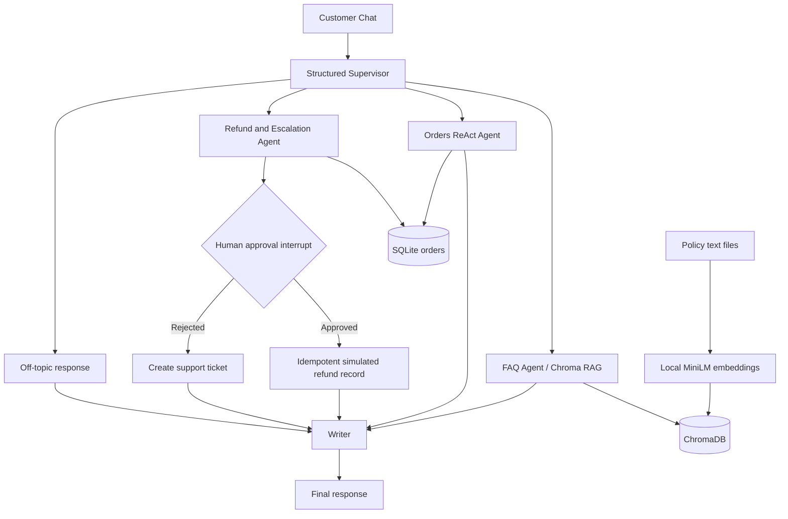

# SupportCopilot

A portfolio demo of a multi-agent customer support assistant for fictional ShopEasy. It uses LangGraph, Groq, local sentence-transformers embeddings, ChromaDB, SQLite, and Streamlit. All customer/order data is synthetic. Refund records are simulated; no money is moved.

## Architecture



## Setup (Windows PowerShell)

1. Install `uv` from https://docs.astral.sh/uv/getting-started/installation/
2. In the project directory:
   ```powershell
   uv init
   uv venv
   .venv\Scripts\Activate.ps1
   Copy-Item .env.example .env
   ```
3. Add your own Groq API key to `.env`. Never commit it.
4. Verify on https://console.groq.com/docs/models that `openai/gpt-oss-20b` is available and supports tool calling. If not, change `MODEL_NAME` in `config.py` to a currently available model with tool calling and structured output.
5. Install:
   ```powershell
   uv pip install -r requirements.txt
   ```
6. Run security and RAG smoke tests:
   ```powershell
   python test_security.py
   python test_rag.py
   ```
7. Run CLI:
   ```powershell
   python run_agent.py
   ```
8. Run Streamlit:
   ```powershell
   streamlit run app.py
   ```

The SQLite seed data and Chroma index are generated automatically. Streamlit Community Cloud has ephemeral local storage, so its demo database and vector index are recreated when absent after restart. For production, use managed persistent storage and real authentication.

## LangSmith

Set `LANGCHAIN_TRACING_V2=true`, `LANGCHAIN_API_KEY`, and `LANGCHAIN_PROJECT` in `.env`. Do not print or commit API keys. Capture screenshots of a successful trace and add them here:
- `docs/screenshots/langsmith-overview.png` (placeholder)
- `docs/screenshots/langsmith-tool-call.png` (placeholder)

## Human approval and idempotency

Refund requests over USD 50 pause with `interrupt()`. The approval record is written to SQLite before interruption so a separate dashboard session can find it. The side effect is after the interrupt and uses a unique idempotency key in SQLite. A resumed interrupt node may execute again from its start; therefore do not perform side effects before `interrupt()`. This is a demo record, not a payment integration.

## Evaluation

Run:
```powershell
python eval/run_eval.py
```

Fill this table only with measurements from your own run. The starter harness is a smoke test and does not yet instrument tool-call accuracy or provide a robust semantic judge.

| Metric | Your measured result |
|---|---|
| Routing accuracy | TBD |
| Tool-use accuracy | TBD |
| Rule-based answer correctness | TBD |
| Guardrail pass rate | TBD |
| Cross-customer data leaks | TBD |

## Demo notes

Suggested demo flow: ask a policy question; list orders; attempt a foreign order lookup; request a refund above the threshold and show the pending approval dashboard. Record a GIF only after the flows are verified.

## Limitations

- All data and refunds are simulated.
- This is a portfolio prototype, not production financial software.
- The starter evaluator uses simple string checks and can have false positives/negatives.
- Validate current LangGraph, Groq, and checkpointer APIs against their official docs before deployment.
